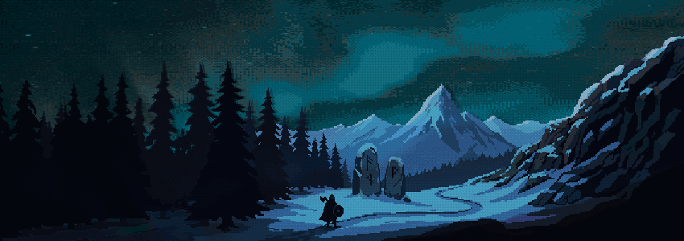

<!-- Banner: upload banner.gif into this same repo, next to this README.md, and the image below will render full-width at the top of your profile. -->


# Soham Pansare / Infindev
### AI & Data Science · Full-Stack · Indie Game Dev · Mumbai, India

---

```
~$ cat about.txt

→ 3rd-yr B.E. AI&DS @ VCET, Vasai (Mumbai University, 2024–28)
→ Ex-Intern @ Surfboard Ventures — production features for EdQuest (B2B + B2C)
→ Building StockSense — AI inventory + POS for kirana stores
→ Shipped 5 jam games under Infindev on itch.io
→ Learning Unity — aiming for game dev roles
```

---

## 🛠 Stack

**Languages** &nbsp; `Python` `Java` `JavaScript / TypeScript` `C#`  
**Frontend** &nbsp; `React` `Vite` `Leaflet`  
**Backend** &nbsp; `FastAPI` `Express.js` `n8n (self-hosted)`  
**Data / AI** &nbsp; `PyTorch` `MongoDB Atlas` `Vector Search` `Claude API` `RAG pipelines` `ONNX`  
**Game Dev** &nbsp; `Unity` `Godot` `Pygame` `GDevelop` `Bitsy` `MakeCode Arcade`  
**Infra** &nbsp; `Docker` `uv` `GitHub Actions`

---

## 🔭 Featured Projects

| Project | Stack | What it does |
|---|---|---|
| **[StockSense](https://github.com/Infindev7/StockSense)** 🚧 | Gemini API · n8n · MongoDB · Telegram · React | AI-powered inventory manager for kirana stores — vision, NLP, RAG, and a POS billing terminal |
| **Terramorph** 🎮 | Godot · ONNX · Python · β-VAE | Procedural terrain morphing with a β-VAE — 5 latent sliders morph live terrain in Godot, with walk mode and a day/night cycle |
| **SLM from Scratch** 🧠 | PyTorch · nanoGPT · Kaggle T4 | 29.94M-param decoder-only Transformer trained from scratch on TinyStories — val loss 1.70, perplexity ~5.5, coherent story generation |
| **RoadPulse** | Godot · FastAPI · MongoDB · React/Leaflet | Crowdsourced road quality detection via IMU/GPS — shock-delta model, geohash nodes, live heatmap |
| **[NeuralOps](https://github.com/Surajphirke3/Codex_hackthon)** | OpenAI · React · FastAPI | AI agent observability & control platform — built at the OpenAI Codex Community Hackathon |
| **[ChronoSphere](https://github.com/JanhaviChitre/ChronoSphere)** | React · FastAPI · MongoDB | Distributed team scheduler modelling "timezone fatigue" as a first-class UX concept |
| **[Infindev Games](https://infindev.itch.io)** 🎮 | Godot · Pygame · GDevelop · Bitsy | 5 shipped jam games across 5 different engines |

---

## 📈 GitHub Stats


---

## 🌱 Currently Learning

```
✦ Unity + Game AI — building towards game dev roles
✦ PyTorch — SLM trained from scratch, now pushing into deeper ML
✦ DSA in Java — ramping up on LeetCode (easy → medium → hard)
✦ RAG pipeline architecture + agentic systems design
✦ Reading: Designing Data-Intensive Applications — Martin Kleppmann
```

---

## 🎮 By the Numbers

- **5** jam games shipped across 5 engines
- **30M**-param SLM trained from scratch (val loss 1.70, perplexity ~5.5)
- **3+** full-stack projects in production or near-production
- **1** academic paper in progress (IEEE format — RoadPulse)
- **∞** builds in progress

---

## 📫 Find Me

[](https://infindev.itch.io)
[](https://linkedin.com/in/soham-pansare-118978293)
[](https://github.com/Infindev7)

---

<sub>Builder-first. Project-led. Always shipping.</sub>
